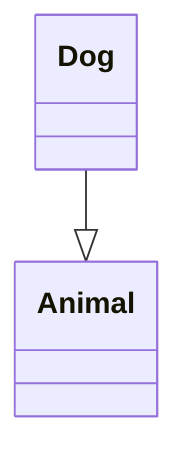

# AgenticAI Data Contracts

This document defines the data structures, message formats, and contracts that AI agents must follow for seamless integration.

## Core Message Structure

All agents use a consistent message format based on OpenAI's conversation model:

```python
Message = {
    "role": str,      # "system" | "user" | "assistant"
    "content": str    # Text content (may contain markdown)
}
```

### Role Definitions

| Role | Origin | Meaning | Typical Content |
|------|--------|---------|-----------------|
| `system` | Agent init | System prompt defining role | "You are a C programmer..." |
| `user` | Designer/developer | Input prompt or task | "Write a program to..." |
| `assistant` | LLM response | Generated output | Code, analysis, or explanation |

### Message History Contract

```python
# Valid message sequence:
messages = [
    # System prompt (first message, always)
    {"role": "system", "content": "You are a C programmer..."},
    
    # Alternating user/assistant
    {"role": "user", "content": "Write factorial in C"},
    {"role": "assistant", "content": "```c\nint factorial(...)...\n```"},
    
    {"role": "user", "content": "Add error checking"},
    {"role": "assistant", "content": "```c\nif (n < 0) ...\n```"}
]

# Properties guaranteed:
# - messages[0]["role"] == "system" (always)
# - messages[1]["role"] == "user" (always after system)
# - Subsequent roles alternate between "user" and "assistant"
# - No consecutive messages with same role
# - All content is string type
```

## Code Block Extraction Contract

### C Code Blocks

```markdown
Here's a C program:

```c
#include <stdio.h>
int main() { printf("Hello\\n"); return 0; }
```

More explanation...
```

**Extraction Regex:** `r"```c(.*?)```"`
**Expected Return:** Pure C code without markdown markers

```python
# Input (from LLM response)
markdown = """```c
#include <stdio.h>
int main() { return 0; }
```"""

# Output (extracted code)
code = """#include <stdio.h>
int main() { return 0; }"""
```

### Python Code Blocks

```markdown
Here's Python code:

```python
def factorial(n):
    return 1 if n <= 1 else n * factorial(n-1)
```
```

**Extraction Regex:** `r"```python(.*?)```"`

### Mermaid Diagram Blocks

```markdown
Here's a class diagram:


```

**Extraction Regex:** `r"```mermaid(.*?)```"`

## Code Compilation Contract (AgentAIC)

### Input Contract

```python
# Agent expects markdown with C code:
prompt_response = """
Here's a factorial function:

```c
#include <stdio.h>
int factorial(int n) {
    if (n <= 1) return 1;
    return n * factorial(n - 1);
}
```
"""
```

### Processing Contract

```python
# Agent guarantees:
# 1. Extract code from ```c ... ``` block
extracted = """#include <stdio.h>
int factorial(int n) {
    if (n <= 1) return 1;
    return n * factorial(n - 1);
}"""

# 2. Write to ./temp/code_temp.c
with open("./temp/code_temp.c", "w") as f:
    f.write(extracted)

# 3. Compile with exact command:
#    gcc -w code_temp.c -o a.out -lm
#    
#    Flags meaning:
#    - -w: suppress warnings
#    - -lm: link math library (for sqrt, sin, etc.)
#    Output: ./temp/a.out

# 4. Parse stderr for "error" keyword
#    If found, retry with fix prompt (max 3 times)

# 5. Return original response or None
```

### Output Contract

```python
# Success case:
response = """
Here's a factorial function:

```c
#include <stdio.h>
int factorial(int n) {
    if (n <= 1) return 1;
    return n * factorial(n - 1);
}
```
"""
# - Code compiles without "error" in stderr
# - Added to messages as {"role": "assistant", "content": response}
# - Logged via logger.log_agent_action()

# Failure case (after 3 compilation attempts):
response = None
# - Logged via logger.log_agent_action() with error details
# - NOT added to messages
# - Caller handles None gracefully
```

## Python Execution Contract (AgentAIPy)

### Input Contract

```python
# Agent expects markdown with Python code:
prompt_response = """
Here's a function to calculate factorial:

```python
def factorial(n):
    return 1 if n <= 1 else n * factorial(n - 1)

print(factorial(5))
```
"""
```

### Processing Contract

```python
# Agent guarantees:
# 1. Extract code from ```python ... ``` block
# 2. Execute with: python3 <script>
#    Timeout: config.PYTHON_EXECUTION_TIMEOUT (30 seconds)
# 3. Capture stdout and stderr
# 4. If stderr indicates error, retry with fix prompt (max 3 times)
# 5. Return original response or None
```

### Output Contract

```python
# Success case:
response = """Here's a function to calculate factorial:

```python
def factorial(n):
    return 1 if n <= 1 else n * factorial(n - 1)

print(factorial(5))  # Outputs: 120
```"""

# Failure case:
response = None
```

## Logger Contract

### Log Action Contract

```python
# Every significant operation is logged:
logger.log_agent_action(
    agent_id="00",           # 2-digit sequential ID
    action="Sending prompt to LLM",
    details="Model - ollama/qwen3:4b, ..."
)

# Properties:
# - agent_id: Always 2-digit string "00" to "99"
# - action: Short description of operation
# - details: Additional context (may contain multi-line data)
# - Timestamp added automatically
# - Logged to execution.log if enabled
```

### Log Exception Contract

```python
logger.log_exception(
    agent_id="00",
    exception=TimeoutError("timeout"),
    context="get_response",
    error_type="TimeoutError",  # Optional
    is_retryable=True          # Optional
)

# Properties:
# - Full traceback captured
# - Error type extracted
# - Context for debugging
# - Timestamp added automatically
```

## Agent ID Contract

### ID Generation Contract

```python
from agent_id_manager import AgentIDManager

# Each agent gets unique sequential ID:
id1 = AgentIDManager.get_next_id()  # Returns "00"
id2 = AgentIDManager.get_next_id()  # Returns "01"
id3 = AgentIDManager.get_next_id()  # Returns "02"

# Properties:
# - 2-digit string format
# - Incremental: 00, 01, 02, ..., 99
# - Wraps around at 100 (resets to 00)
# - Singleton: only one counter instance
# - NOT reset between get_next_id() calls

# For deterministic testing:
AgentIDManager.reset()  # Resets counter to 0
```

## Message Queue Contract

### Message Structure

```python
class Message:
    message_id: int          # Auto-generated by queue
    sender: str              # Agent identifier
    recipient: str           # Target agent or "broadcast" or "anyone"
    payload: Dict[str, Any]  # JSON-serializable data
    timestamp: datetime      # Auto-generated
    
# Valid recipient patterns:
# - "agent_00", "programmer_01": Targeted message
# - "broadcast": All agents receive (implicit)
# - "anyone": First agent to retrieve gets it
```

### Send Message Contract

```python
mq = MessageQueue()

mq.send_message(
    sender="designer_00",
    recipient="programmer_01",
    payload={
        "task_id": 1,
        "requirement": "Write factorial in C",
        "metadata": {"priority": "high"}
    }
)

# Properties:
# - Payload must be JSON-serializable
# - Timestamp auto-added
# - Returns message_id for tracking
# - Thread-safe
```

### Retrieve Message Contract

```python
# Get messages for specific agent:
messages = mq.get_messages(agent_id="programmer_01")

# Returns: List[Message]
# - Only targeted messages matching agent_id
# - Does NOT return "anyone" messages
# - Does NOT return "broadcast" messages
# - Empty list if no messages

# Mark as processed:
if messages:
    msg = messages[0]
    mq.delete_message(msg.message_id)
```

### Broadcast Contract

```python
# Send to all agents:
mq.send_message(
    sender="compiler_02",
    recipient="broadcast",
    payload={"result": "success", "output_file": "./a.out"}
)

# All agents can see broadcast:
all_messages = mq.get_all_messages()
broadcasts = [m for m in all_messages if m.recipient == "broadcast"]
```

## Configuration Contract

All agents must respect `config.py` constants:

```python
import config

# API Configuration
api_key = os.getenv(config.API_KEY_ENV_VAR)  # "OPENAI_API_KEY"
server = config.SERVERS["local_ollama"]      # "http://localhost:11434"

# LLM Behavior
temperature = config.LLM_TEMPERATURE_GENERATION  # 0.5 (creative)
temperature_fix = config.LLM_TEMPERATURE_FIXING  # 0.3 (deterministic)
max_tokens = config.LLM_MAX_TOKENS               # 16000
timeout = config.LLM_TIMEOUT_SECONDS             # 300
retries = config.LLM_RETRY_ATTEMPTS              # 3

# Compilation
compiler_flags = config.COMPILER_FLAGS      # ["-w", "-lm"]
compiler_trials = config.COMPILER_MAX_TRIALS # 3
source_file = config.COMPILER_SOURCE_FILE   # "./temp/code_temp.c"

# File Organization
results_dir = config.RESULTS_DIR             # "./results/"
temp_dir = config.TEMP_DIR                   # "./temp/"
```

## Data Export Contract

### CSV Export

```csv
role$content
system$You are a C programmer
user$Write a hello world program
assistant$```c
#include <stdio.h>
int main() { printf("Hello World\n"); return 0; }
```
```

**Format:** `$ delimiter` between role and content
**Encoding:** UTF-8
**Special handling:** Newlines preserved as literal `\n`

### Excel Export

```python
# DataFrame structure:
# Column 1: "role" (system, user, assistant)
# Column 2: "content" (full text including markdown)
# Rows: One message per row
# Index: Not included in file
```

### HTML Export

```html
<table>
  <tr>
    <th>Designer</th>
    <th>Programmer</th>
  </tr>
  <tr>
    <td>Write a program...</td>
    <td><pre><code class="c">...</code></pre></td>
  </tr>
</table>
```

**Format:**
- Two-column table
- Designer (user) messages on left
- Programmer (assistant) messages on right
- Code blocks with syntax highlighting
- Markdown converted to HTML

## Error Handling Contract

### Retry Behavior

```python
# Timeout or Connection Error (retryable):
# 1. Log error
# 2. Attempt retry (if attempts < config.LLM_RETRY_ATTEMPTS)
# 3. If max retries exceeded, return None

# Compilation Error (retryable for AgentAIC):
# 1. Parse stderr for "error" keyword
# 2. Generate fix prompt including error message
# 3. Retry LLM generation (if trials < config.COMPILER_MAX_TRIALS)
# 4. If max trials exceeded, return None

# Other Errors (non-retryable):
# 1. Log exception
# 2. Return None immediately
```

### Exception Classification

```python
error_type = type(e).__name__

is_retryable = isinstance(e, (
    TimeoutError,
    ConnectionError,
    ConnectionResetError
))

# Timeout errors:
# - Identified by "timeout" in str(error)
# - Should retry

# Connection errors:
# - isinstance(e, ConnectionError)
# - Should retry

# Other errors:
# - Type errors, value errors, etc.
# - Log but don't retry
```

## Invariants

These must **always** hold:

1. **Message order:** First message is always system prompt
2. **Role alternation:** User/assistant roles alternate (never consecutive)
3. **Type consistency:** agent_id is always 2-digit string
4. **Configuration consistency:** All constants from config.py are used
5. **Logging coverage:** Every significant operation logged
6. **Resource cleanup:** MessageQueue closed when done
7. **No concurrent modifications:** Thread-safe operations only
8. **Timeout respected:** All API calls honor config.LLM_TIMEOUT_SECONDS

## Compatibility Rules

- **Backwards compatible:** New fields in config.py must have defaults
- **Type hints:** All function signatures include type hints
- **Docstrings:** All public methods have comprehensive docstrings
- **Logging:** All errors logged with context
- **Tests:** All contracts verified by unit tests with mocking
