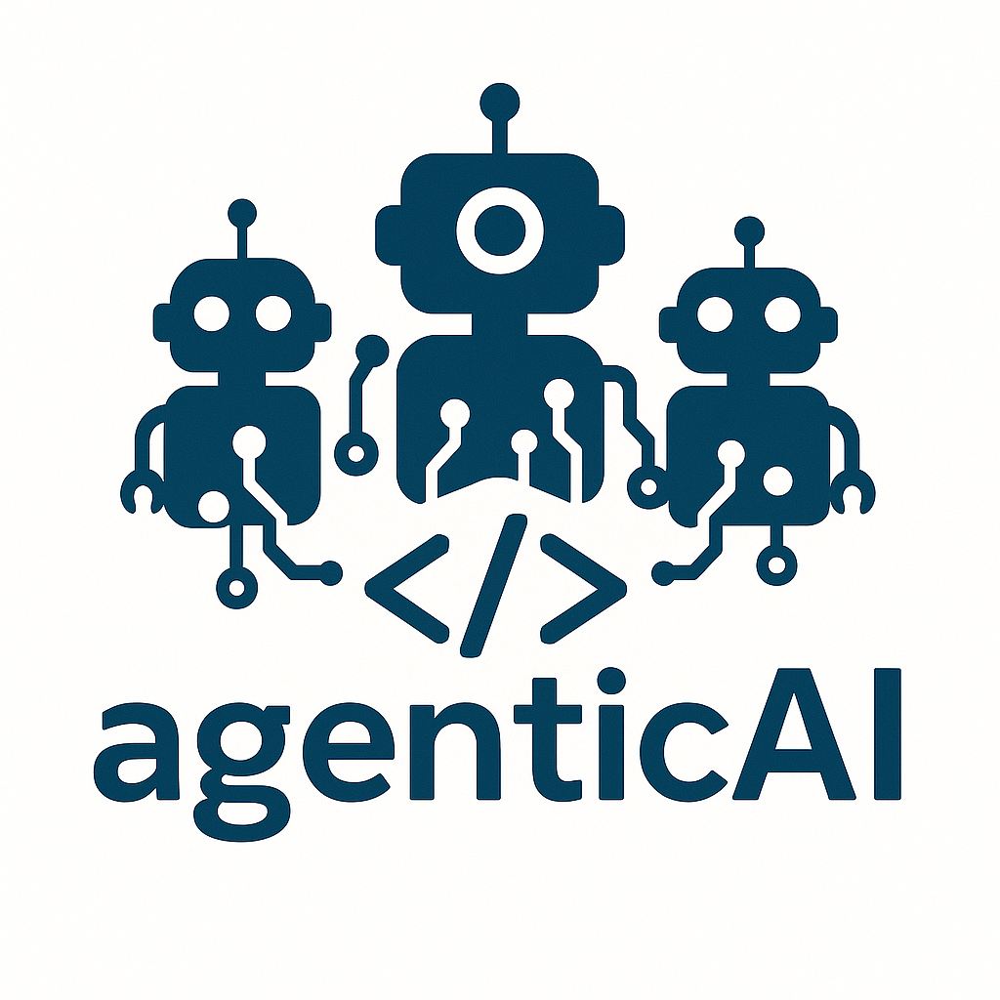
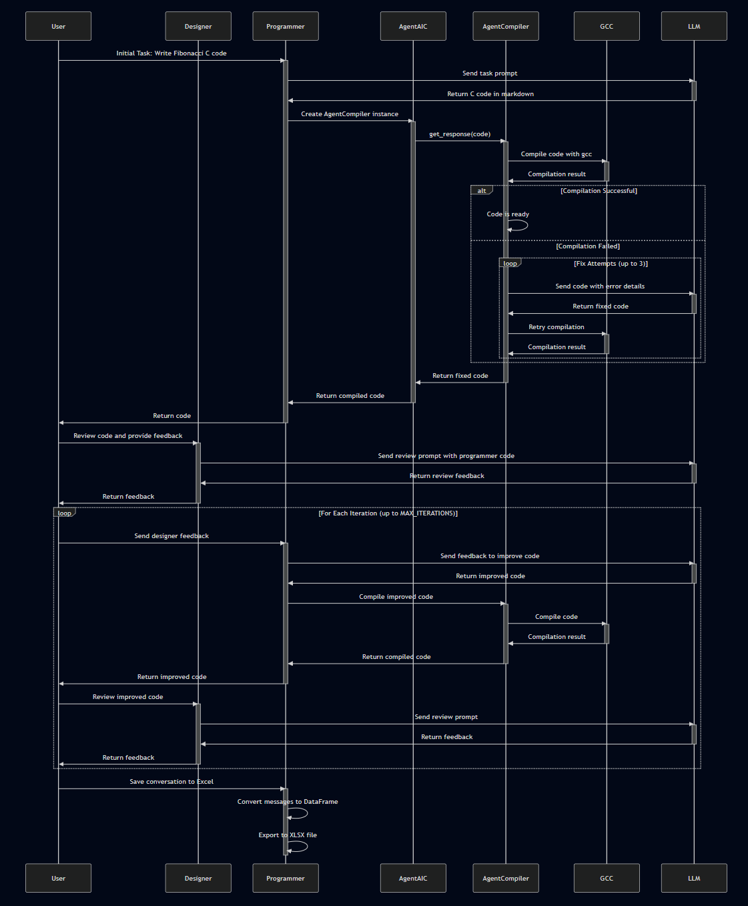
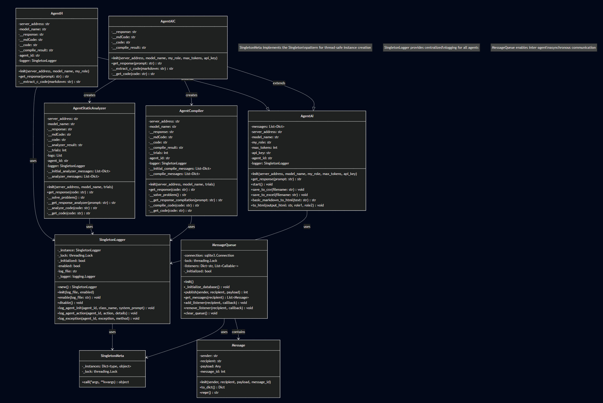

# AgenticAI for Software Engineering

This project is a research framework that enables multi-agent AI conversations for several software engineering tasks: 
* code generation,
* diagram generation, 
* requirement specification, and 
* source code analysis. 

It allows different AI models to collaborate as designers, programmers, compilers, and even incorporate human feedback in the development loop. 

## Quick Start

```bash
# Install dependencies
pip install -r requirements.txt

# Run a basic conversation
python main.py --prompt "Write a C program to calculate factorial"

# Run with compilation validation
python main_agentc.py --prompt "Write a linked list in C"

# Run with human-in-the-loop
python main_human.py --prompt "Review this code design"
```

## Documentation

📚 **New to AgenticAI?** Start here:

- **[User Guide](README_UserGuide.md)** - Complete guide for using the framework
- **[Examples](examples/)** - Working examples with Fibonacci problems
- **[Custom Agents Guide](README_CustomAgents.md)** - Create your own specialized agents

📖 **Additional Documentation:**

- **[Logging Guide](README_Logging.md)** - Debug and monitor agent activities
- **[Message Queue](README_MessageQueue.md)** - Inter-agent communication
- **[Diagram Agent](README_AgentDiagram.md)** - Generate Mermaid diagrams from code

## Features

- **Multi-Agent Conversations**: Create conversations between AI agents with specific roles
- **C Code Generation**: Specialized agents for C programming with compilation support
- **Human-in-the-Loop**: Integrate human feedback into AI conversation flows
- **Code Validation**: Automatic compilation and error fixing with gcc
- **Conversation Persistence**: Save all conversations to Excel/CSV/HTML for analysis
- **Extensible Architecture**: Easy to create custom agents for specific tasks
- **Comprehensive Logging**: Track all agent activities for debugging and research

## Available Agents

- **AgentAI** - Base agent for LLM conversations
- **AgentAIC** - C code agent with automatic compilation
- **AgentCompiler** - Compilation error detection and fixing
- **AgentStaticAnalyzer** - Static code analysis without compilation
- **AgentH** - Human-in-the-loop interaction
- **AgentDiagram** - Mermaid diagram generation from source code

## Architecture & Class Diagram

The project follows a modular architecture with a base `AgentAI` class and specialized agent subclasses:

**Key Design Patterns:**
- **Singleton Pattern**: SingletonLogger and MessageQueue ensure single instances across the application
- **Inheritance**: AgentAIC and AgentH extend the base AgentAI class
- **Composition**: AgentAIC uses AgentCompiler and AgentStaticAnalyzer for specialized tasks
- **Message-based Communication**: MessageQueue enables asynchronous inter-agent communication

See `class_diagram.mmd` for the raw Mermaid diagram file.

## Execution Flow - Fibonacci with Compiler Example

The following sequence diagram shows how a typical conversation flows through the system using the `fibonacci_with_compiler.py` example:



**Key Points in the Flow:**
1. **Initial Code Generation**: Programmer agent generates C code from the task prompt
2. **Automatic Compilation**: AgentCompiler validates the code using gcc
3. **Error Recovery**: If compilation fails, the AgentCompiler attempts to fix errors (up to 3 attempts)
4. **Design Review**: Designer agent reviews the compiled code and provides feedback
5. **Iterative Improvement**: The cycle repeats with designer feedback for multiple iterations
6. **Conversation Persistence**: All exchanges are saved to an Excel file for later analysis

See `sequence_diagram_fibonacci.mmd` for the raw Mermaid diagram file.

## What happens in the code

The framework provides a base `AgentAI` class that manages conversations with Language Models. Scripts instantiate multiple agents with different roles (designer, programmer, etc.) and orchestrate conversations between them. Each agent maintains conversation history and can save results for analysis.



## API Keys

If you want to use OpenAI servers or another server with an API key, set the `OPENAI_API_KEY` environment variable:

```bash
export OPENAI_API_KEY="your_token_here"
```

## MessageQueue - Inter-Agent Communication

The project now includes a lightweight, thread-safe message queue for inter-agent communication using an in-memory SQLite database.

**Key Features:**
- Simple API: `publish()`, `get_messages()`, and `listen()`
- Three recipient modes: specific recipient, "broadcast", or "anyone" (first-come-first-served)
- Thread-safe operations
- Listener/hook support for automatic message handling
- JSON-serializable payloads

**Quick Example:**
```python
from messagequeue import MessageQueue

mq = MessageQueue()
mq.publish("Agent1", "Agent2", "Hello!")
messages = mq.get_messages("Agent2")
mq.close()
```

**Documentation:**
- Full API reference: [README_MessageQueue.md](README_MessageQueue.md)
- Usage examples: `examples_messagequeue.py`
- Integration examples: `integration_examples_messagequeue.py`
- Run tests: `python -m unittest test.test_messagequeue -v` 