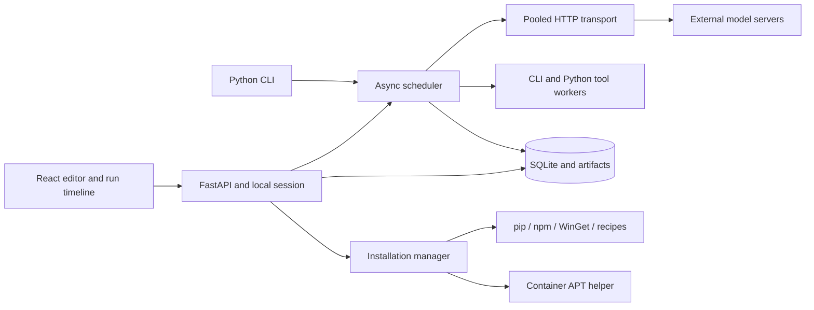
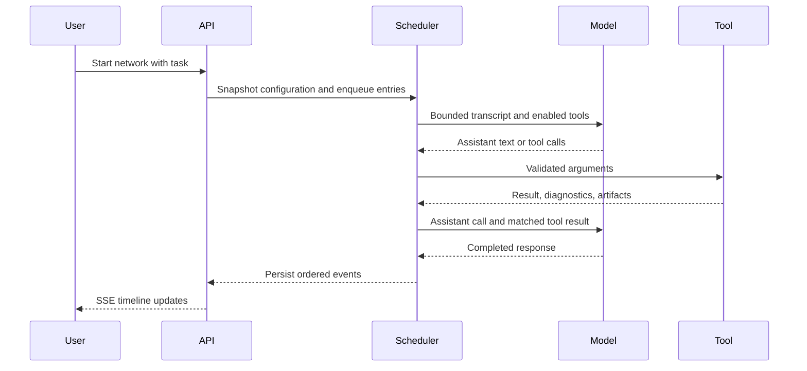

# AgenticAI Studio architecture

AgenticAI Studio runs a visual agent editor and an execution engine on your computer. The same Python package powers the web server and command-line runner. Model inference happens on external HTTP servers, or in the deterministic demo adapter.

## Components

The frontend is compiled once and shipped inside the wheel. End users do not need Node.js unless they use npm tools. FastAPI serves the UI, tutorial, documentation, REST API, and event stream from one origin. Run the server with one worker. A file lock prevents two applications from using the same data directory.

## Execution model

Each run copies its network, provider profiles, and tool definitions into an immutable SQLite snapshot. Runtime changes affect a separate working network. The final working network is recorded even after cancellation or failure. The original saved network changes only when the user explicitly saves an evolved copy.

The editor renders a Start node for the network's saved `initial_task`, with outgoing connections representing `entry_agents`. It is a configuration view, not an agent that calls a model. At startup the scheduler enqueues the task for each selected entry. The run API can override the task without modifying the saved network. Communication templates accept `{task}` to include that original task alongside `{message}`, the previous agent's output. The default Programmer/Designer example starts with Programmer and alternates code generation and design feedback for three visits each.

The scheduler processes message waves. Every destination with queued messages receives one activation per wave; messages arriving together are combined and identify their senders. Independent destinations run concurrently. Each agent has a lock, so its transcript cannot be updated by overlapping activations. Feedback links deliver in the following wave, bounded by maximum visits and run limits.

In workflow mode, outgoing links route completed output using a text template and a condition. `{message}` inserts output. Supported conditions are always, contains, not_contains, and equals. A join buffers one message from each incoming predecessor, combines a complete set, and forwards the result. All incoming branches must deliver. An unresolved join fails with a diagnostic rather than returning an incomplete result. Joins match FIFO messages per predecessor, so repeated branches must preserve their order; they do not implement arbitrary cross-round correlation.

Human nodes emit a human-input event and wait on a future. The UI or CLI provides the response. Time when every unfinished activation is waiting for a human is excluded from the active-time budget. A pause prevents new waves and subsequent model calls; requests and tools already running can finish. Cancellation propagates to child tasks and subprocess trees.

## Autonomous agents

Autonomous agents receive their enabled tool schemas. Agents with orchestration enabled also receive `send_message`, `broadcast`, `publish`, `spawn_agent`, `delegate`, `connect_agents`, and `subscribe`.

Direct messages and delegation require an outgoing link. Broadcast reaches outgoing neighbors. Topic publication reaches connected subscribers. Agents may add/remove their own outgoing links and subscriptions. Children inherit the parent's provider, model parameters, and a subset of its tools. The parent controls whether a child also receives orchestration capability.

Delegation records a parent for the target's next completion. The result enters the parent's inbox asynchronously. An agent may have only one outstanding delegation as a target. Invalid tool calls become tool-error responses; run budget violations terminate execution. Quiescence, with no remaining inbox work or incomplete joins, completes a run.

## Model transport and context

One long-lived HTTPX asynchronous client reuses connections. Global model concurrency defaults to four and per-endpoint concurrency to two. Requests retry transient connection failures, timeouts, HTTP 429, and server errors with bounded backoff. Authentication and other client errors fail immediately. Cancellation stops waiting locally; a remote inference server may continue processing an already submitted request.

The transport sends a conservative UTF-8 byte estimate for context, reserving output tokens and serialized tool definitions. It drops complete old user turns and retains system messages and complete assistant/tool exchanges. An oversized current turn is rejected with instructions to increase context or reduce input. This is not an exact tokenizer or a guarantee about a particular provider's tokenization. Full transcripts remain in SQLite; completed runtime objects are released.

Ollama and vLLM use their compatible chat-completion HTTP servers. Configure the complete endpoint URL. Native tool calling requires both the chosen model and server configuration to support it. The provider checkbox is the user's capability declaration; the connection test reports whether the model actually called the probe tool. No in-process GPU dependency is installed by default. The old embedded-vLLM module remains a legacy path.

## Persistence and recovery

`studio.sqlite3` uses WAL mode and a busy timeout. Schema version 1 is recorded in `PRAGMA user_version`; newer schemas are rejected by older applications. Tables store reusable objects, immutable runs, ordered events, and complete messages. SQLite writes are serialized with a lock and committed incrementally.

Artifacts live under `runs/`, `tool-tests/`, and `installations/`. Downloads are constrained to those directories. Large logs are files rather than long model messages. JSON/CSV/HTML/optional Excel exports are generated on demand. HTML content is escaped and spreadsheet formulas are neutralized.

On startup, unfinished runs and installation jobs become interrupted. The application does not replay model calls, tool side effects, or half-completed installations. Inspect the transcript and start a new run. Back up the data directory while the server is stopped, or use SQLite's backup mechanism.

## Local trust boundary

The server binds to loopback by default. Mutating requests require a local session token and matching Origin when supplied. Host validation reduces DNS-rebinding exposure. Credentials are environment-variable references, and configured secrets are redacted in persisted messages/events and tool logs. Tool subprocesses receive a reduced environment plus explicitly mapped variables.

CLI tools and Python plugins are trusted executable code. Shell access deliberately permits commands with the application's OS permissions. This is not an OS sandbox. A shell can read accessible files, access the network, and invoke package managers independently. The app does not offer its installation API as a model tool, but unrestricted shells are not prevented from installing user-space software. Enable them only where those capabilities are intended.

In Docker, agent execution uses UID/GID 1000. A separate root helper exposes only validated APT package operations over a local authenticated Unix socket. The helper has no host Docker socket. Shell-capable agents share the app's container identity; the helper is an installation service, not an isolation boundary between mutually untrusted agents. This is a single-user application, not a multi-tenant service.

## Extension points

Python tools use the `agenticai.tools` entry-point group. CLI tools need only a configuration definition. Additional installer backends use executable-and-argument recipes. REST types are represented by Pydantic models and published in OpenAPI. Network JSON uses `schema_version: 1`. See the tool, deployment, API, and performance guides for examples.
